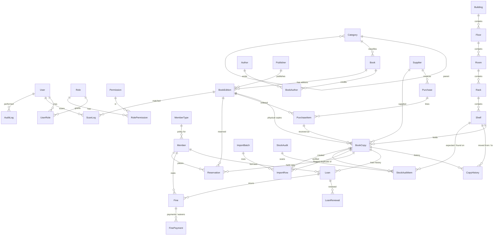

# Database Design

## Core entities
- User, Role, Permission, UserRole/RolePermission as appropriate.
- Book (bibliographic title/edition).
- Author.
- BookAuthor (many-to-many).
- Publisher.
- Category.
- BookCopy (one row per physical item).
- Building, Floor, Room, Rack, Shelf (or a validated hierarchical location model).
- Supplier.
- Purchase, PurchaseItem.
- Member.
- Loan/BookTransaction.
- Reservation.
- Fine.
- ScanLog.
- ImportBatch, ImportRow.
- StockAudit, StockAuditItem.
- ConditionHistory.
- AuditLog.

## Critical relationships
- Book 1:N BookCopy.
- Book M:N Author through BookAuthor.
- Category 1:N Book (or a join table if multiple categories are required).
- Publisher 1:N Book (or edition-level publisher if editions are modeled separately).
- Shelf 1:N BookCopy.
- Member 1:N Loan.
- BookCopy 1:N historical Loan records.
- Purchase 1:N PurchaseItem; received items link to created BookCopy records.
- ImportBatch 1:N ImportRow.
- StockAudit 1:N StockAuditItem.

## Important modelling decision
If separate editions need different ISBNs, publishers, publication years or metadata, model `Book` as a title/work and `BookEdition` as the edition-level record. Then `BookEdition` has many `BookCopy` records. Decide and document this before migrations. Do not put multiple ISBNs into one scalar field.

## Constraints
- Unique accession number (non-null for registered physical copies).
- Unique author number when supplied.
- ISBN normalized and indexed; do not assume ISBN is always present or globally unique across bad legacy data.
- Foreign keys for relationships.
- Explicit enums for copy status, condition and acquisition type.
- Timestamps on mutable records.
- Soft archive for catalogue records; preserve transactional records.
- Index common search and filter columns.
- Add PostgreSQL trigram/full-text indexes through reviewed SQL migrations if Prisma schema cannot express the required index.

## Copy statuses
AVAILABLE, ISSUED, RESERVED, DAMAGED, MISSING, UNDER_REPAIR, DISCARDED, PENDING_VERIFICATION.

## Acquisition types
LEGACY_OLD_STOCK, PURCHASED_NEW, DONATED, TRANSFERRED, OTHER.

## Required design review
Before coding, produce an ER diagram and explain edition modelling, author numbering, accession-number generation, location hierarchy, purchase-to-copy relationship, and circulation history.

---

# Reviewed design (implemented in `backend/prisma/schema.prisma`)

**Status (2026-11-16):** baseline migration `20261116000000_init`, with 36 tables, 19 enums, 56 foreign keys, the `pg_trgm` extension, 3 partial unique indexes, 4 trigram indexes and 23 CHECK constraints.
- The schema passes `prisma validate`, and the migration SQL was generated with `prisma migrate diff`. Client typecheck and unit tests pass.
- **The migration has not been applied to a database yet**, because local credentials are not configured. Run the commands under "Verification" below to apply it and check it.

## Relationship review (2026-11-16)
Before regenerating the baseline, every relation was reviewed. These changes were made:

| # | Finding | Fix |
|---|---|---|
| 1 | `CopyHistory.fromShelfId/toShelfId` had no foreign key, so history could point at shelves that don't exist | FK → `shelves` (RESTRICT) |
| 2 | `StockAuditItem.expectedShelfId/foundShelfId` had no FK | FK → `shelves` |
| 3 | `ImportRow.duplicateOfCopyId` had no FK | FK → `book_copies` |
| 4 | One copy could be held for two reservations; a member could hold duplicate open reservations for one edition | Partial unique indexes `reservations_one_hold_per_copy_key` and `reservations_one_open_per_member_edition_key`, plus CHECK `reservations_hold_chk` |
| 5 | Fines kept only a running total, so individual payments and waivers were lost | New `fine_payments` table (append-only, kind PAYMENT/WAIVER) |
| 6 | One-active-loan rule used a mirror column (`activeCopyId`) | Replaced by the partial unique index `loans_one_active_per_copy_key` on `copyId WHERE status = 'ACTIVE'` |
| 7 | Nothing in the database checked ISBN format, blank identifiers, or loan status against return date | Added CHECK constraints (table below) |
| 8 | No indexes for partial/fuzzy search | `pg_trgm` GIN indexes on title, author, publisher and member names |
| 9 | No index for per-edition availability counts; member email/phone not indexed | `book_copies(editionId, status)`, `members(email)`, `members(phone)` |

**Polymorphic reference kept on purpose:** `StockAudit.scopeId` points to a building, floor, room, rack or shelf depending on `scopeType`. A single FK cannot express that. A CHECK constraint guarantees the id is present exactly when the scope is not LIBRARY, and the service layer (Phase 8) validates that the target exists.

**Category tree:** `categories.parentId` is a self-reference. Cycles (A → B → A) cannot be stopped by a simple constraint, so the Phase 2 service rejects them.

## ER diagram



Supporting tables: `settings` (key/JSON library policies) and `number_sequences` (identifier generators). User foreign keys that record *who did it* (issued/returned by, recorded by, started by and so on) are left out of the diagram for readability.

## Table catalogue
| Area | Tables |
|---|---|
| Identity & access | `users`, `roles`, `permissions`, `user_roles`, `role_permissions` |
| Configuration | `settings`, `number_sequences` |
| Catalogue | `books` (works), `book_editions`, `book_authors`, `authors`, `publishers`, `categories` |
| Inventory | `book_copies`, `copy_history` |
| Locations | `buildings`, `floors`, `rooms`, `racks`, `shelves` |
| Acquisition | `suppliers`, `purchases`, `purchase_items` |
| Circulation (transactions) | `member_types`, `members`, `loans`, `loan_renewals`, `reservations`, `fines`, `fine_payments` |
| Digitisation | `scan_logs`, `import_batches`, `import_rows` |
| Verification | `stock_audits`, `stock_audit_items` |
| Audit | `audit_logs` |

"Transactions" in the requirements means circulation transactions. A loan is the issue/return transaction, and renewals, fines and fine payments are its follow-up records. None of these rows is ever deleted.

## Enums
| Enum | Values |
|---|---|
| `CopyStatus` (stock status) | AVAILABLE, ISSUED, RESERVED, DAMAGED, MISSING, UNDER_REPAIR, DISCARDED, PENDING_VERIFICATION |
| `CopyCondition` (book condition) | NEW, GOOD, FAIR, POOR, DAMAGED |
| `AcquisitionType` | LEGACY_OLD_STOCK, PURCHASED_NEW, DONATED, TRANSFERRED, OTHER |
| Others | ContributorRole, MetadataSource, CopyEventType, PurchaseStatus, MemberStatus, LoanStatus, ReservationStatus, FineStatus, FinePaymentKind, ScanMode, ScanOutcome, ImportBatchStatus, ImportRowStatus, StockAuditScope, StockAuditStatus, StockAuditResult |

## Modelling decisions

### 1. Edition modelling: Book → BookEdition → BookCopy
- **Book** is the work/title: title, subtitle, description, category, contributors.
- **BookEdition** is the manifestation an ISBN identifies: ISBN-13/10, edition statement, publisher, year, language, pages, cover, metadata source, verification.
- **BookCopy** is one physical item.

The same title commonly exists in several editions with different ISBNs, publishers and years. A single `Book` table would force either duplicate titles or several ISBNs in one field, and the rules above forbid both. Legacy books without an ISBN still get an edition row, with `isbn13 = NULL`.

Contributors (`BookAuthor`) attach at the **work** level, with a `role` (AUTHOR, EDITOR, TRANSLATOR, ILLUSTRATOR, COMPILER) and a display `position`. *Known limitation:* contributors specific to one edition (such as the translator of one edition) are recorded at the work level for now. An `EditionContributor` table can be added later without breaking existing data.

ISBNs are stored **normalised**:
- `isbn13` is 13 digits with a 978/979 prefix; ISBN-10 input is converted.
- `isbn10` is 9 digits plus a check character (0–9 or X).
- The format is enforced by CHECK; check digits are validated in code (`backend/src/lib/isbn.ts`).

ISBNs are **indexed but not unique**, because legacy registers contain shared or incorrect ISBNs. Duplicates are handled by a workflow (Phase 4/5) that offers to add another copy of the existing edition.

### 2. Author numbering
`Author.authorNumber` is an optional string that is **unique when present** (PostgreSQL allows many NULLs) and never blank (CHECK). It is a string because libraries use Cutter, Cutter-Sanborn or local codes (e.g. `S527`). Names are deliberately *not* unique, since different authors can share a name; the author number tells them apart. Whether numbers are entered manually or generated, and in what format, will be a library setting in Phase 2. No format is hard-coded.

### 3. Accession numbers
`BookCopy.accessionNumber` is required, **globally unique** and never blank (CHECK). Numbers come from two sources:
1. **Legacy registers:** numbers are kept exactly as imported (Phase 5). Conflicts are reported, never overwritten.
2. **New copies:** numbers are generated from `number_sequences` (`key`, `prefix`, `nextValue`, `padding`). The next value is taken with a row lock (`SELECT … FOR UPDATE`) in the same transaction that inserts the copy, so concurrent registrations never collide. Prefix and padding are configurable. Gaps from rolled-back transactions are acceptable.

`BookCopy.barcode` (unique) is the value the label encodes. By default it equals the accession number, never the ISBN.

### 4. Location hierarchy
Separate tables for `Building > Floor > Room > Rack > Shelf`, each child unique by `(parentId, code)`. Copies reference only `shelfId`, which is nullable while a copy awaits shelving, and the full path comes from joins. Foreign keys keep the hierarchy valid (a shelf cannot belong to two racks), and lookups and audits by shelf or room stay simple.

### 5. Purchase-to-copy relationship
A `Purchase` (supplier invoice header, unique per supplier + invoice number) has many `PurchaseItem` rows: edition, quantity, `receivedQuantity`, unit price, tax and line total. Copies are created **only when items are received** (Phase 6). Each received unit becomes a `BookCopy` with `purchaseItemId`, `supplierId`, `acquisitionType = PURCHASED_NEW` and its own `acquisitionPrice`. CHECK constraints enforce `0 ≤ receivedQuantity ≤ quantity` and non-negative amounts.

### 6. Circulation history
- `Loan` rows are never deleted. A return sets `status = RETURNED` and `returnedAt`, and CHECK `loans_status_chk` keeps the two consistent.
- **The database itself prevents double issue.** The partial unique index `loans_one_active_per_copy_key` (`UNIQUE (copyId) WHERE status = 'ACTIVE'`) means two concurrent issues of the same copy cannot both commit, while any number of RETURNED loans remain as history. The issue transaction will also lock the copy row and check `status = AVAILABLE`.
- Renewals are kept in `LoanRenewal`: previous due date, new due date (must be later), and who renewed.
- Each `Fine` links to a member and optionally to a loan. Every payment or waiver is a `FinePayment` row (append-only). `Fine.paidAmount` is their running total, updated in the same transaction and capped by CHECK at `amount`.
- Reservations are placed on an **edition**, with at most one open reservation per member and edition. A specific copy is assigned when held (`READY_FOR_PICKUP`), and a copy can be held for only one reservation.
- Loan period, renewals, grace period, fine per day, borrowing limit and hold days live in `MemberType`, per member category. No circulation defaults are hard-coded.

### 7. Status & history
`CopyStatus`, `CopyCondition` and `AcquisitionType` are PostgreSQL enums. Every change to a copy's status, condition or location adds a `CopyHistory` row with from/to shelf foreign keys; this table is the "ConditionHistory" entity. Security-sensitive and inventory actions add `AuditLog` rows (user, action, entity, before/after JSON, IP, request id).

### 8. Soft archive vs. preserved history
Catalogue and master tables have an `archivedAt` column. Transactional tables (loans, renewals, fines, fine payments, purchases, imports, scans, stock audits, copy history, audit logs) have no delete path and use `ON DELETE RESTRICT` foreign keys. Only pure join rows (`user_roles`, `role_permissions`, `book_authors`) cascade.

## Unique constraints
| Table | Unique key |
|---|---|
| `book_copies` | `accessionNumber`; `barcode` (when present) |
| `authors` | `authorNumber` (when present) |
| `publishers`, `categories`, `suppliers` | `normalizedName`; `categories.code` (when present) |
| `floors` / `rooms` / `racks` / `shelves` | `(buildingId, code)` / `(floorId, code)` / `(roomId, code)` / `(rackId, code)`; `buildings.code` |
| `purchases` | `(supplierId, invoiceNumber)` |
| `members`, `member_types` | `membershipNumber`, `code` |
| `loans` | `copyId WHERE status = 'ACTIVE'` (partial) |
| `reservations` | `(memberId, editionId) WHERE status IN (PENDING, READY_FOR_PICKUP)`; `assignedCopyId WHERE status = 'READY_FOR_PICKUP'` (partial) |
| `import_rows` | `(batchId, rowNumber)`; `createdCopyId` |
| `stock_audit_items` | `(auditId, copyId)`, so a copy is counted once per audit |
| `users`, `roles`, `permissions` | `email`, `code`, `code` |

Partial indexes are declared in the Prisma schema (preview feature `partialIndexes`, Prisma 7.10), so Prisma's drift detection understands them.

## Integrity rules (CHECK constraints in the baseline migration)
| Constraint | Rule |
|---|---|
| `book_copies_identifiers_chk` | accession number and barcode not blank |
| `authors_author_number_chk` | author number not blank when present |
| `members_number_chk` | membership number not blank |
| `book_editions_isbn_format_chk` | `isbn13 ~ ^97[89]\d{10}$`, `isbn10 ~ ^\d{9}[\dX]$` |
| `book_editions_numbers_chk` | page count > 0; publication year 1000–2999 (sanity bound) |
| `authors_years_chk` | death year ≥ birth year |
| `book_authors_position_chk` | position ≥ 0 |
| `shelves_capacity_chk` | capacity ≥ 0 |
| `book_copies_price_chk` | price ≥ 0 |
| `purchase_items_amounts_chk` | quantity > 0; 0 ≤ received ≤ quantity; prices, tax and discount ≥ 0 |
| `purchases_amounts_chk` | totals ≥ 0 |
| `fines_amounts_chk` | 0 ≤ paid ≤ amount |
| `fine_payments_amount_chk` | amount > 0 |
| `member_types_policy_chk` | all policy numbers non-negative; loan period > 0 |
| `members_dates_chk` | expiry ≥ join date |
| `loans_status_chk` | ACTIVE ⇔ no return date; RETURNED ⇔ return date |
| `loans_dates_chk` | due after issue; return not before issue; renewals ≥ 0 |
| `loan_renewals_dates_chk` | new due date after previous |
| `reservations_hold_chk` | READY_FOR_PICKUP requires an assigned copy |
| `stock_audits_scope_chk` | scope id present exactly when scope ≠ LIBRARY |
| `import_rows_number_chk` | row number ≥ 1 |
| `import_batches_counts_chk` | counts and file size ≥ 0 |
| `number_sequences_chk` | `nextValue ≥ 1`; padding 0–20 |

Prisma does not manage CHECK constraints, so later `prisma migrate dev` runs leave them intact. New CHECKs go into new migrations as reviewed SQL.

## Indexes
- **B-tree** indexes on every foreign key used in lookups, plus:
  - `books.normalizedTitle`, `authors.normalizedName`, `book_editions.isbn13`/`isbn10`
  - `book_copies(editionId, status)`, `status`, `shelfId`, `acquisitionType`
  - `loans(status, dueAt)` and `(memberId, status)`
  - `reservations(editionId, status, reservedAt)`
  - `members` email/phone/status
  - `scan_logs.normalizedIsbn`
  - audit-log entity and time
- **Trigram (GIN, `gin_trgm_ops`)** for partial and fuzzy search (`ILIKE '%…%'`, `similarity()`):
  - `books.normalizedTitle`
  - `authors.normalizedName`
  - `publishers.normalizedName`
  - `members.fullName`
- `pg_trgm` is a trusted extension (PostgreSQL 13+), so the non-superuser database owner `library_app` can install it.

Search columns (`normalizedTitle`, `normalizedName`) hold `normalizeText()` output (`backend/src/lib/text.ts`): NFKC, lower-case, collapsed whitespace, diacritics kept.

## Seed data
| Command | Contents | Environments |
|---|---|---|
| `npm run db:seed` | Permission catalogue, system roles, first ADMIN from `SEED_ADMIN_*` env vars | All. Idempotent; never changes an existing password |
| `npm run db:seed:demo` | **Demo-only** library (below) | Refuses `NODE_ENV=production`; skipped if any book or copy exists |

The demo library (`backend/src/db/demo-seed.ts`) exercises every relationship:
- **Locations:** 1 building, 2 floors, 3 rooms, 4 racks, 12 shelves.
- **Catalogue:** 5 categories (including a sub-category), 8 publishers, 8 authors with demo author numbers. There are 7 works and 8 editions: *Pride and Prejudice* has two editions, one with no ISBN; *Freakonomics* has two authors; *Gitanjali* has no ISBN. The ISBNs are real and check-digit verified.
- **Copies:** 13 copies covering every copy status. Legacy register numbers are `1001`–`1009`; purchased copies are `DEMO-00001`–`00004`, linked to a received purchase. The `ACCESSION` sequence continues at `DEMO-00005`.
- **Circulation:** 2 demo member types (policy values clearly labelled demo) and 4 members, one suspended. Loans: 1 active, 1 overdue, and 1 returned after a renewal with a part-paid fine. Reservations: one ready-for-pickup hold and one pending.
- **Imports, audits, scans:** an import batch with imported, duplicate and invalid rows; a completed rack audit with found, misplaced and unknown-barcode results; scan history.

## Verification
```powershell
cd backend
npx prisma migrate deploy     # apply the baseline
npm run db:seed               # roles + admin
npm run db:seed:demo          # optional demo library
npm run db:verify             # read-only catalogue check against this design
npm run test:integration      # 15 auth + 24 schema tests on DATABASE_URL_TEST
```
`db:verify` (`backend/scripts/verify-database.ts`) checks applied migrations, all 36 tables, the required unique, partial and trigram indexes, ≥ 23 CHECK constraints, `pg_trgm` and the core enums. It exits non-zero on any gap.

`tests/integration/schema.int.test.ts` loads the demo data and then tries to break each rule:
- duplicate or blank accession numbers, duplicate author numbers, malformed ISBN
- deleting an edition that has copies, duplicate shelf codes on one rack
- over-receiving a purchase, a second active loan, an inconsistent loan status
- duplicate reservations or holds, overpaying a fine, invalid policy values, audit scope
- it also checks import and history links and trigram search

## Conventions
- UUIDv7 primary keys (`uuid` type, time-ordered).
- snake_case table names; camelCase columns, quoted in raw SQL (e.g. `"accessionNumber"`).
- Money as `NUMERIC(12,2)`.
- `createdAt`/`updatedAt` timestamps on mutable tables.
